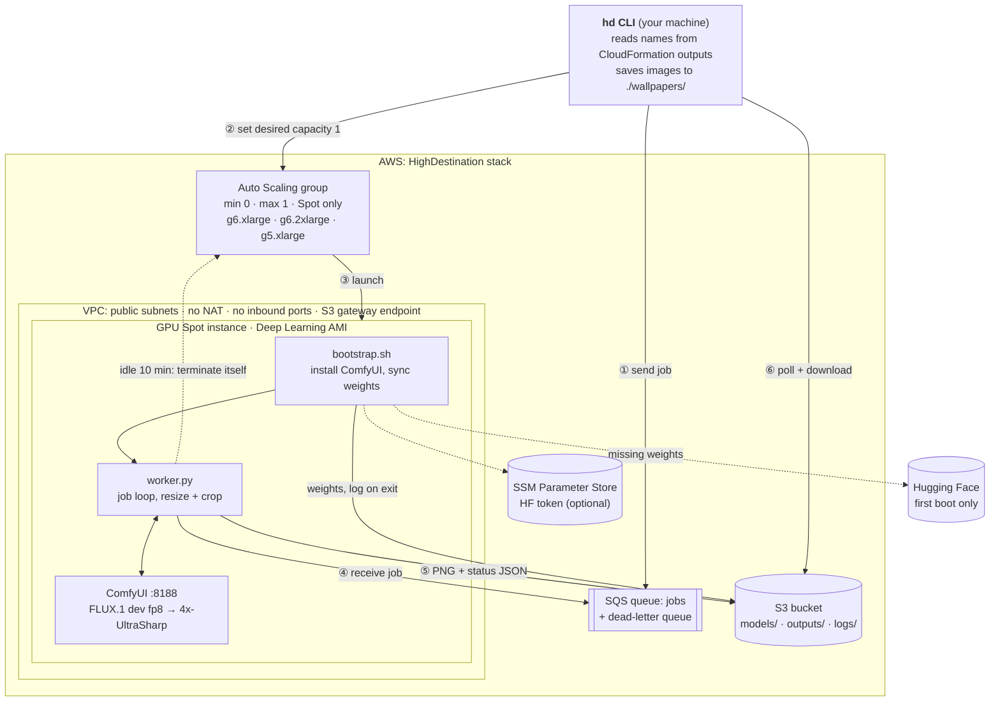

# High Destination

*High (not mid) Destination (not journey): life is about the journey, but an
image is about the result.*

A personal, self-hosted image generator (mainly wallpapers) on AWS — a cheap,
fully customizable alternative to Midjourney for a few images per month.
Generation speed is not a concern; cost and control are.

> Status: v0.1 — CDK stack, GPU worker and `hd` CLI written; not yet deployed/tested on AWS.

## Quick start

Prerequisites: AWS credentials, Python 3.10+, Node.js (for the CDK CLI), and a
**G-instance Spot quota** ("All G and VT Spot Instance Requests" ≥ 4 vCPUs,
or 8 to allow g6.2xlarge) in your region.

```bash
# 1. Deploy (once per account/region: npx aws-cdk bootstrap)
cd infra
python3 -m venv .venv && . .venv/bin/activate && pip install -r requirements.txt
npx aws-cdk deploy                       # optional: -c budgetEmail=you@example.com

# 2. Install the CLI
pip install -e ../cli

# 3. Generate
hd gen "misty norwegian fjord at dawn, cinematic, volumetric light" --preset ultrawide
hd gen "neon tokyo alley in rain" --ratio 9:16 --count 3
hd gen "minimal desert dunes" --size 3440x1440 --seed 42
hd presets | hd status | hd stop | hd logs | hd fetch <job_id>
```

The **first** job takes longest (~10–15 min): the worker installs ComfyUI and
downloads ~17 GB of weights from Hugging Face, then caches them in the S3
bucket. Later cold starts copy from S3 (a few minutes). Images land in
`./wallpapers/`.

### Architecture (as built)



### How it runs

- `hd gen` puts a job on SQS and sets the Auto Scaling group to 1 (Spot only:
  g6.xlarge → g6.2xlarge → g5.xlarge, price-capacity-optimized, 2–3 AZs).
- The instance (Deep Learning Base AMI, Ubuntu 22.04) runs `worker/bootstrap.sh`:
  ComfyUI (pinned version in `infra/cdk.json`) on the NVMe instance store,
  weights from `s3://<bucket>/models/`, then `worker/worker.py` pulls jobs.
- Each job: FLUX.1 [dev] fp8 at ~1 MP in the target shape → 4x-UltraSharp →
  Lanczos resize + center crop to exact pixels → `s3://<bucket>/outputs/`.
- After 10 idle minutes (`idleMinutes` in `infra/cdk.json`) the worker uploads
  its log to `s3://<bucket>/logs/` and terminates itself. Any boot failure also
  terminates. Backstops: ASG max instance lifetime 1 day, optional $10 budget.
- No NAT gateway, no inbound ports. Debug a live worker with SSM Session Manager.

Models are listed in `worker/models.txt`. If a URL is gated on Hugging Face,
store a token: `aws ssm put-parameter --name /high-destination/hf-token --type SecureString --value hf_...`

Not built yet: outpainting for ratios beyond 2.5:1 (currently cropped),
LLM prompt expansion, LoRAs, a baked AMI for faster cold starts, the web page.

---

The original plan follows.

## Goals

- Own the tool end to end and customize it freely (models, LoRAs, workflows).
- **Aspect ratio control is the most important feature** (see below).
- Scale to zero: pay only while generating. Target ~$2–5/month.

## Architecture

```
Client (CLI / small web page / Telegram bot — TBD)
  → API Gateway + Lambda → SQS queue (jobs)
  → CloudWatch alarm on queue depth → ASG desired capacity 0 → 1
  → GPU Spot instance running ComfyUI headless
      pulls jobs, generates, upscales, writes PNGs to S3
  → idle ~10 min → sets ASG back to 0 / shuts down
```

Alternative: AWS Batch with a GPU Spot compute environment (min vCPU = 0).
Avoid SageMaker (price markup; serverless inference has no GPUs).

### Choices

- **Model:** FLUX.1 [dev] (non-commercial license — fine for personal use).
  Others to consider: SD 3.5 Large, Qwen-Image, FLUX.1 [schnell] (Apache 2.0).
- **Instance:** g6.xlarge (L4 24GB) Spot, ~$0.30–0.40/hr, ~30–50 s per 1024px image.
  g5.xlarge (A10G) is a slightly faster alternative.
- **Weights:** stored in S3 (~30–40 GB, ~$1/month), copied to the instance at boot.
- **Prompting:** optional LLM prompt-expansion step to close the
  "Midjourney aesthetic" gap; LoRAs / IP-Adapter / Redux for style references.
- **IaC:** AWS CDK (Python). **Client:** CLI first, web page later.

## Aspect ratios (core requirement)

Requests accept either a ratio (`"16:9"`), exact target pixels (`"3440x1440"`),
or a preset (`desktop`, `ultrawide`, `phone`, …).

Rule: generate at **~1 megapixel in the target shape** (sides multiple of 16),
then upscale 4x (Real-ESRGAN / 4x-UltraSharp), then crop/resize to exact pixels.
Never generate directly at final resolution (causes duplicated subjects and
broken composition).

| Ratio   | Use              | Generate at | Final (example)      |
|---------|------------------|-------------|----------------------|
| 1:1     | avatar / tablet  | 1024×1024   | 4096×4096            |
| 16:9    | desktop          | 1344×768    | crop → 3840×2160     |
| 21:9    | ultrawide        | 1536×640    | → 3440×1440          |
| 3:2     | laptop           | 1216×832    | → 3000×2000          |
| 9:16    | phone            | 768×1344    | → 1440×2560          |
| ~9:19.5 | modern iPhone    | 672×1472    | → 1179×2556          |

Beyond ~2.5:1 (e.g. 32:9 dual monitor): generate at 21:9 or 16:9 and
**outpaint** the sides with FLUX Fill, in the same ComfyUI workflow.

## Cost guardrails / gotchas

1. Request G-instance quota early: "Running On-Demand G and VT instances" and
   "All G and VT Spot Instance Requests" (often 0 on personal accounts).
2. **No NAT Gateway** (~$32/month). Public subnet or S3 VPC endpoint.
3. Idle-shutdown script on the instance + max-lifetime Lambda + AWS Budget alarm ($10).
4. Prefer S3 for weights over a persistent EBS volume.

## Fallbacks

- Amazon Bedrock pay-per-image (Stability / Nova Canvas, ~$0.04–0.14/image).
- Local on Apple Silicon (Draw Things / ComfyUI) — free, slow.
