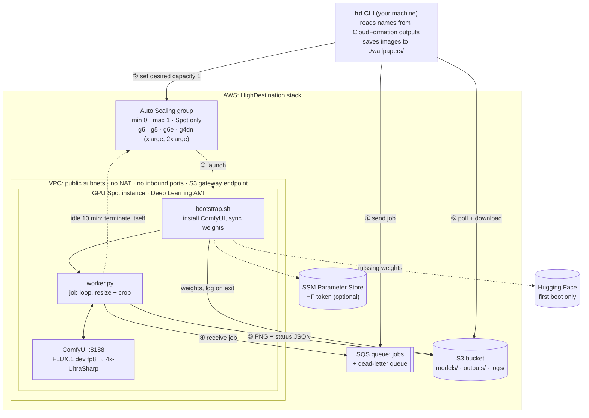

# High Destination

*High (not mid) Destination (not journey): life is about the journey, but an
image is about the result.*

A personal, self-hosted image generator (mainly wallpapers) on AWS — a cheap,
fully customizable alternative to Midjourney for a few images per month.
Generation speed is not a concern; cost and control are.

> Status: v0.3 — CDK stack, GPU worker, `hd` CLI, and a web UI that runs locally
> (`hd serve`) or on AWS behind a Cognito login (https://highdestination.ahmetsay.com).

## Quick start

Prerequisites: AWS credentials, Python 3.10+, Node.js (for the CDK CLI), and a
**G-instance Spot quota** ("All G and VT Spot Instance Requests" ≥ 4 vCPUs,
or 8 to allow the 2xlarge sizes) in your region.

```bash
# 1. Deploy (once per account/region: npx aws-cdk bootstrap)
cd infra
python3 -m venv .venv && . .venv/bin/activate && pip install -r requirements.txt
npx aws-cdk deploy --all                 # optional: -c budgetEmail=you@example.com

# 2. Install the CLI
pip install -e ../cli

# 3. Generate
hd gen "misty norwegian fjord at dawn, cinematic, volumetric light" --preset ultrawide
hd gen "neon tokyo alley in rain" --ratio 9:16 --count 3
hd gen "minimal desert dunes" --size 3440x1440 --seed 42
hd presets | hd status | hd stop | hd logs | hd fetch <job_id>
```

### Web UI (local)

```bash
pip install -e '../cli[web]'
hd serve --open                          # http://localhost:8000, this machine only
```

A prompt box, a size picker with a live shape preview (preset, ratio or exact
pixels), variations, seed/steps/guidance, a gallery of your images with a
lightbox (download, reuse settings, new variation, delete), and a worker status
bar with Logs and Stop. Jobs submitted from the CLI show up there too.

The server binds to 127.0.0.1 and has no login (it acts with your AWS
credentials). It is a static page plus a JSON API (`cli/hd/web.py`, docs at
`/api/docs`) that keeps no state of its own and hands images to the browser as
presigned S3 URLs, so the same code runs on AWS (below).

### Web UI (on AWS, for you only)

Deployed by the same `npx aws-cdk deploy` when `web` is `true` in
`infra/cdk.json` (it is). The address is `webDomain` there
(`highdestination.ahmetsay.com`); set it to `""` to use the `*.cloudfront.net`
address instead.

```
Browser ─► CloudFront  https://highdestination.ahmetsay.com
            ├─ /*      private S3 bucket: cli/hd/static + generated config.js
            └─ /api/*  API Gateway HTTP API ─ JWT authorizer (Cognito) ─► Lambda: the same FastAPI app
           Cognito: managed login page (app-styled, dark), no self sign-up, TOTP MFA required
```

**DNS and certificate.** CloudFront needs its certificate in us-east-1, so if
your stack is elsewhere (e.g. eu-central-1) a small `HighDestinationCert` stack
is created there. Bootstrap us-east-1 once as well, then deploy both stacks:

```bash
npx aws-cdk bootstrap aws://<account-id>/us-east-1
npx aws-cdk deploy --all
```

- If `ahmetsay.com` is a Route 53 hosted zone in this account, add
  `-c hostedZone=ahmetsay.com` (or put it in `cdk.json`). Validation and the
  DNS record are then automatic.
- Otherwise (DNS at your registrar or elsewhere), two manual records:
  1. While the deploy waits at the certificate, open ACM in us-east-1, copy
     the validation CNAME (name and value) and add it to your DNS. The deploy
     continues once ACM sees it (usually a few minutes).
  2. After the deploy, add a CNAME `highdestination` → the `DnsCname` stack
     output (`dxxxx.cloudfront.net`).

**Create your login** (once; the invitation email has a temporary password):

```bash
POOL=$(aws cloudformation describe-stacks --stack-name HighDestination --query "Stacks[0].Outputs[?OutputKey=='UserPoolId'].OutputValue" --output text)
aws cognito-idp admin-create-user --user-pool-id $POOL --username <you> --user-attributes Name=email,Value=<your email> Name=email_verified,Value=true
aws cognito-idp admin-add-user-to-group --user-pool-id $POOL --username <you> --group-name admin
```

Open the site, sign in, choose a new password and scan the MFA QR code with an
authenticator app. Members of the `admin` group get the worker controls and
share `outputs/local/` with the CLI, so both show the same gallery. Anyone else
you add gets a private folder (`outputs/<cognito sub>/`) and no worker controls.

How it is protected: no sign-up, MFA, and every `/api` request needs a valid
Cognito access token. API Gateway's JWT authorizer checks it, and the app
checks the claims again (`cli/hd/auth.py`). The API is throttled to 10
requests/s, and the page is served with a strict Content-Security-Policy.
Sign-in lasts 30 days (refresh token in the browser's local storage).
Expected cost: well under $1/month (Cognito Essentials is free up to 10,000 monthly users;
Lambda, API Gateway and CloudFront requests cost cents).

**After upgrading to v0.2, redeploy once** (`npx aws-cdk deploy`) so the worker
writes results per user (`outputs/<user>/…`) and creates gallery thumbnails.
Until then the UI and CLI still find results from the old worker; older images
stay where they are and are listed too.

The **first** job takes longest (~10–15 min): the worker installs ComfyUI and
downloads ~17 GB of weights from Hugging Face, then caches them in the S3
bucket. Later cold starts copy from S3 (a few minutes). Images land in
`./wallpapers/`.

### Architecture (as built)



### How it runs

- `hd gen` puts a job on SQS and sets the Auto Scaling group to 1 (Spot only,
  price-capacity-optimized across 3 AZs). Eight instance types (`instanceTypes`
  in `infra/cdk.json`) so a Spot shortage of one GPU doesn't block the worker:
  g6 (L4), g5 (A10G), g6e (L40S) and g4dn (T4, slower), each in xlarge and
  2xlarge, all within an 8-vCPU Spot quota. The ASG takes whichever has
  capacity, weighing price. If no worker appears, `aws autoscaling
  describe-scaling-activities` shows why (`UnfulfillableCapacity` = no Spot
  capacity for any of them right now; it keeps retrying).
- The instance (Deep Learning Base AMI, Ubuntu 22.04) runs `worker/bootstrap.sh`:
  ComfyUI (pinned version in `infra/cdk.json`) on the NVMe instance store,
  weights from `s3://<bucket>/models/`, then `worker/worker.py` pulls jobs.
- Each job: FLUX.1 [dev] fp8 at ~1 MP in the target shape → 4x-UltraSharp →
  Lanczos resize + center crop to exact pixels → `s3://<bucket>/outputs/`.
- After 10 idle minutes (`idleMinutes` in `infra/cdk.json`) the worker uploads
  its log to `s3://<bucket>/logs/` and terminates itself. Any boot failure also
  terminates. Backstops: ASG max instance lifetime 1 day, optional $10 budget.
- No NAT gateway, no inbound ports. Debug a live worker with SSM Session Manager.

Models are listed in `worker/models.txt`. If a URL is gated on Hugging Face,
store a token: `aws ssm put-parameter --name /high-destination/hf-token --type SecureString --value hf_...`

Not built yet: outpainting for ratios beyond 2.5:1 (currently cropped),
LLM prompt expansion, LoRAs, a baked AMI for faster cold starts, per-user
limits for users other than you.

---

The original plan follows.

## Goals

- Own the tool end to end and customize it freely (models, LoRAs, workflows).
- **Aspect ratio control is the most important feature** (see below).
- Scale to zero: pay only while generating. Target ~$2–5/month.

## Architecture

```
Client (CLI / small web page / Telegram bot — TBD)
  → API Gateway + Lambda → SQS queue (jobs)
  → CloudWatch alarm on queue depth → ASG desired capacity 0 → 1
  → GPU Spot instance running ComfyUI headless
      pulls jobs, generates, upscales, writes PNGs to S3
  → idle ~10 min → sets ASG back to 0 / shuts down
```

Alternative: AWS Batch with a GPU Spot compute environment (min vCPU = 0).
Avoid SageMaker (price markup; serverless inference has no GPUs).

### Choices

- **Model:** FLUX.1 [dev] (non-commercial license — fine for personal use).
  Others to consider: SD 3.5 Large, Qwen-Image, FLUX.1 [schnell] (Apache 2.0).
- **Instance:** g6.xlarge (L4 24GB) Spot, ~$0.30–0.40/hr, ~30–50 s per 1024px image.
  g5.xlarge (A10G) is a slightly faster alternative.
- **Weights:** stored in S3 (~30–40 GB, ~$1/month), copied to the instance at boot.
- **Prompting:** optional LLM prompt-expansion step to close the
  "Midjourney aesthetic" gap; LoRAs / IP-Adapter / Redux for style references.
- **IaC:** AWS CDK (Python). **Client:** CLI first, web page later.

## Aspect ratios (core requirement)

Requests accept either a ratio (`"16:9"`), exact target pixels (`"3440x1440"`),
or a preset (`desktop`, `ultrawide`, `phone`, …).

Rule: generate at **~1 megapixel in the target shape** (sides multiple of 16),
then upscale 4x (Real-ESRGAN / 4x-UltraSharp), then crop/resize to exact pixels.
Never generate directly at final resolution (causes duplicated subjects and
broken composition).

| Ratio   | Use              | Generate at | Final (example)      |
|---------|------------------|-------------|----------------------|
| 1:1     | avatar / tablet  | 1024×1024   | 4096×4096            |
| 16:9    | desktop          | 1344×768    | crop → 3840×2160     |
| 21:9    | ultrawide        | 1536×640    | → 3440×1440          |
| 3:2     | laptop           | 1216×832    | → 3000×2000          |
| 9:16    | phone            | 768×1344    | → 1440×2560          |
| ~9:19.5 | modern iPhone    | 672×1472    | → 1179×2556          |

Beyond ~2.5:1 (e.g. 32:9 dual monitor): generate at 21:9 or 16:9 and
**outpaint** the sides with FLUX Fill, in the same ComfyUI workflow.

## Cost guardrails / gotchas

1. Request G-instance quota early: "Running On-Demand G and VT instances" and
   "All G and VT Spot Instance Requests" (often 0 on personal accounts).
2. **No NAT Gateway** (~$32/month). Public subnet or S3 VPC endpoint.
3. Idle-shutdown script on the instance + max-lifetime Lambda + AWS Budget alarm ($10).
4. Prefer S3 for weights over a persistent EBS volume.

## Fallbacks

- Amazon Bedrock pay-per-image (Stability / Nova Canvas, ~$0.04–0.14/image).
- Local on Apple Silicon (Draw Things / ComfyUI) — free, slow.
